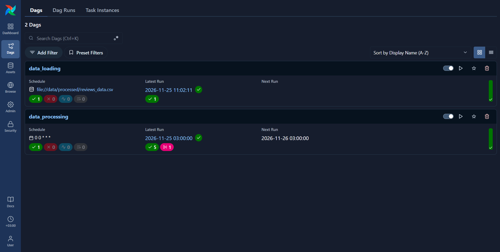
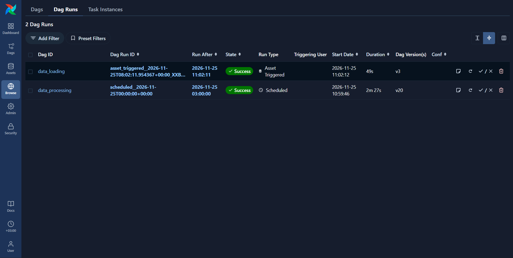
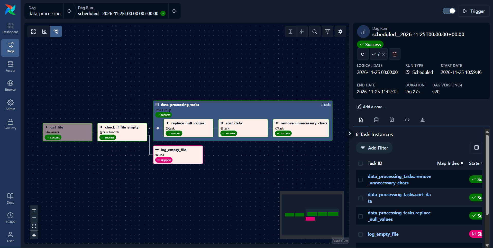

# Airflow mongo pipeline

- Nessessary MongoDB queries are in /queries folder. Files are named accordingly to what a query does. Result examples (some are limited up to 10) to each query are named:
   "[Query number] - Result".
- Airflow is run locally. This example only shows main concept and how everything runs using dummy data. **Security would have to be improved if real data is used.**  
- Do not forget to set your configuration settings in .env file.
- MongoDB is run locally, set your passwords if needed.
- A few containers in docker-compose.yaml (like postgres service) were not needed for this project, but were added just to get practice :p
- Data is supposed to be in /data/raw folder. 
- Picture of data loading dag wasnt included since it consists of only one task.

Pictures of dags and dags runs:

